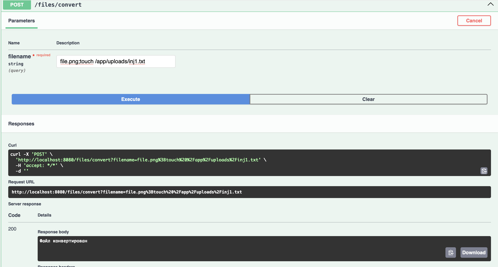
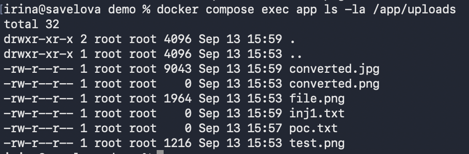
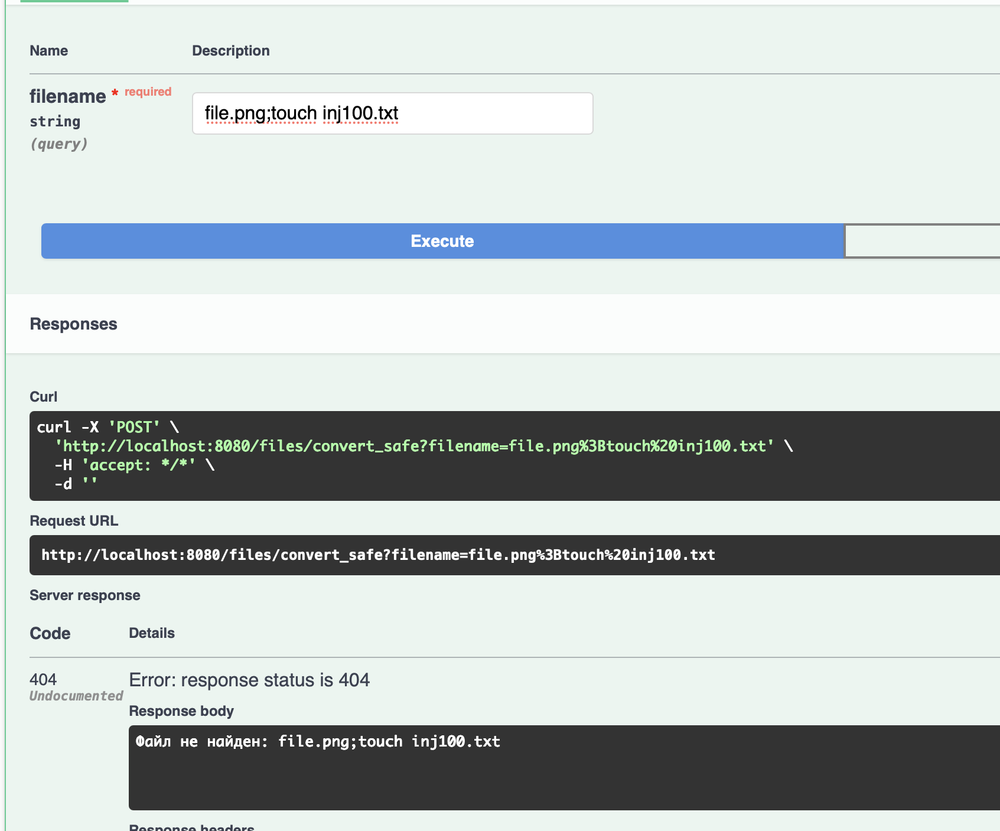

curl -X POST \                             
  'http://localhost:8080/files/convert?filename=file.png%3Btouch%20%2Fapp%2Fuploads%2Fpoc.txt'

Уязвимость OS Command Injection возникает из-за небезопасного формирования команды операционной системы из пользовательского ввода. В обработчике `/files/convert` значение параметра `filename` напрямую подставляется в строку команды конкатенацией, которая затем выполняется через `sh -c`.

Таким образом, приложение позволяет выполнить произвольные команды внутри окружения.

Уязвимость устранена за счёт отказа от выполнения строки команды через `sh -c`. Вместо этого программа `convert` и её аргументы передаются в `ProcessBuilder` отдельно. Благодаря этому пользовательский ввод передаётся в программу convert как отдельный аргумент, поэтому специальные символы не могут быть использованы для выполнения дополнительных команд.

